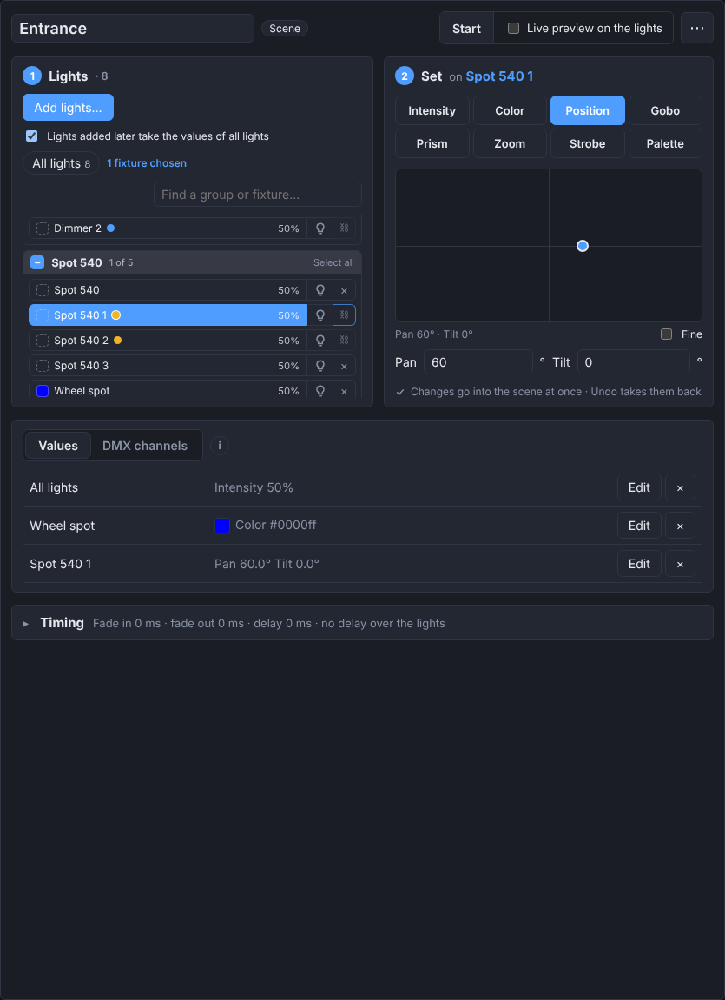
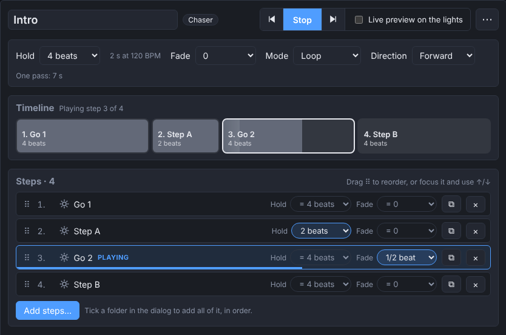

<h1 align="center">kLight</h1>

<p align="center">
  <b>DMX lighting control for live shows, built to never go dark.</b><br>
  Free software · Linux, Windows and macOS · use it from the desktop or from a tablet
</p>

<p align="center">
  <a href="https://github.com/kernel-machine/kLight/actions/workflows/ci.yml"></a>
  <a href="LICENSE"></a>
  
</p>

> [!WARNING]
> **kLight is a work in progress.** It is not finished and has not been proven
> in real shows yet: don't rely on it for an event that matters. There are no
> releases yet, and the show file format may still change. Feedback, bug
> reports and ideas are very welcome.

---

kLight is a lighting console in software, in the spirit of
[QLC+](https://www.qlcplus.org/), designed first of all for **live use**. You
patch your fixtures, build scenes, chasers and effects, lay out a virtual
console and play the show with a mouse, a touch screen or a MIDI controller,
from the computer connected to the lights or from any browser on the same
network.

<p align="center">
  
</p>

## Why kLight

**Robustness comes first.** During a show the DMX output must never stop. The
engine runs in its own process with a watchdog. The interface, a remote
client or an unplugged USB interface can fail without stopping the lights, and
the show saves itself after every change. Every part of the engine is
covered by automated tests, from simulated shows frame by frame to
long-running soak tests with the real clock.

**Think in intentions, not in channels.** You ask for "the front wash in
amber" or "the moving heads pointing at the stage, fanned out", and kLight
works out the DMX values for each fixture: colors, positions in degrees,
strobes in Hz, palettes by name. The channels are always there when you want
them.

**Simple to pick up.** The screens follow the work: choose the lights, set a
value, it's in the scene. Undo is always one click away.

## What it can do today

- **Fixtures**: uses the same `.qxf` fixture definitions as QLC+ (the whole
  library, about 1800 models). Automatic addressing, conflict warnings,
  inverted or upside-down heads, groups with order and a grid.
- **Scenes** with fades, delays spread over a group, times per attribute, a
  live preview on the lights and the color and intensity of each light at a
  glance.
- **Chasers** with a timeline, times per step and jumps to any step;
  **cue lists** with GO / Back / Pause and *move in black*.
- **Effects**: movements (circles, eights, fans with distributed phase) and
  pixel matrix effects, also locked to the tempo in beats; **collections**
  that play several functions together.
- **Virtual console** with buttons, faders, knobs, XY pads, speed dials,
  cue list players and frames. It's designed in *Design mode* and locked in
  *Show mode*.
- **Simple Desk** for quick, selection-based control and palettes.
- **Musical clock**: tap tempo, incoming MIDI clock, chasers and effects that
  follow the beat.
- **Controllers**: MIDI with *learn*, soft takeover and LED color feedback
  (QLC+ controller profiles), and OSC.
- **Outputs**: Enttec DMX USB Pro and Enttec Open DMX, with hot-plug.
- **Remote**: open the interface from a tablet or a phone, with permissions
  (full, playback, read-only).

<p align="center">
  
</p>

## Not there yet

- Packaged releases and installers: for now kLight is built from source.
- Testing in real shows and on more hardware.
- Network outputs (Art-Net, sACN): planned, not in the first version.
- Further ideas (automatic music sync, a 3D view, tracking cue lists…) are in
  the roadmap at the end of the [specification](SPEC.md#17-future-developments-after-v1).

## Try it

You need [Rust](https://rustup.rs/) and [Node.js](https://nodejs.org/) 20 or
later. The full list of system libraries is in
[DEVELOPMENT.md](DEVELOPMENT.md#system-dependencies).

```sh
git clone https://github.com/kernel-machine/kLight.git && cd kLight
scripts/update-qlcplus-fixtures.sh            # the QLC+ fixture library (optional)
cargo install wasm-bindgen-cli --version 0.2.130 --locked
cargo build --release -p klight-engine -p klight-supervisor
cd ui && npm ci && npm run build && cd ..
./target/release/klight-supervisor -- --show my-show.klight.json --ui ui/dist
```

Then open <http://localhost:9400/>. No interface plugged in? Everything works
the same, and the DMX monitor shows what would go out.

The [user guide](docs/user-guide.md) walks through the screens.

## Contributing

kLight is developed in the open and contributions are welcome: bug reports,
fixture problems, ideas, code. Start from [DEVELOPMENT.md](DEVELOPMENT.md) for
how the project is built and tested, and from the [specification](SPEC.md) for
how it is designed.

## License

kLight is free software under the [GNU General Public License, version 3 or
later](LICENSE). The QLC+ fixture definitions and controller profiles it can
download keep their own license (Apache License 2.0) and are not part of this
repository.
